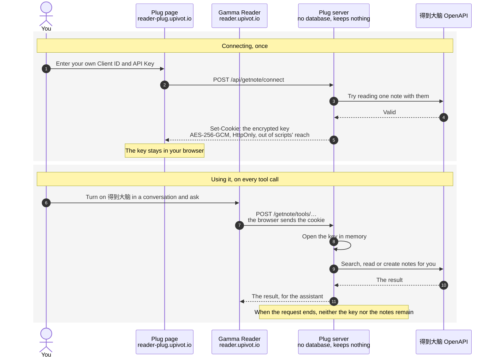

# Gamma Reader Plug

Plugins for [Gamma Reader](https://github.com/bencode/gamma-reader): connect a service once here, then turn it on in a reader conversation to give the reading assistant its tools.

The first plugin is 得到大脑: the assistant can search and read your notes, and save a new note
when you ask. You connect it with an API Key of your own.

## How it works

The plug server (reader-plug.upivot.io) keeps nothing about you: no accounts, no database, no files. Whatever credential a plugin needs is encrypted and kept in a cookie in your own browser. Each time the assistant calls a tool, the browser sends that cookie along; the server opens it in memory, calls the service for you, and drops it when the request ends. Every plugin works this way, including ones added later.

The diagram follows 得到大脑, whose credential is your own Client ID and API Key.



| What                                          | Where                                                                                                                                                     |
| --------------------------------------------- | --------------------------------------------------------------------------------------------------------------------------------------------------------- |
| Your Client ID and API Key                    | Encrypted in a cookie in your browser, valid for 400 days and renewed each time it is used                                                                |
| The key that opens the cookie (`PLUG_SECRET`) | In the server's configuration; one for everyone, tied to no user                                                                                          |
| Note content                                  | Passes through the server during a call; not kept, not logged. What the assistant reads stays in the Reader conversation, in your browser's local storage |
| Your account, identity, usage history         | None: the server has no accounts and no database                                                                                                          |
- **Disconnecting** clears the cookie in this browser only. To revoke the key for good, delete it on the 「API Key」 page of 得到大脑's open platform. A key made just for Reader is easiest to revoke.
- **Another browser or device** needs the key entered again, since it lives only in the first browser.
- **The tools only read and create notes**; they never change or delete one. The API Key itself carries your account's full rights, so treat it like a password.
- **All the code is in this repository**, to check for yourself or to run your own copy.

## Running locally

```sh
cp .env.example .env   # fill in PLUG_SECRET
pnpm install
pnpm dev               # the page at http://localhost:5304, the server at :3304
```

Point a local reader at it with `GAMMA_PLUGINS_URL=http://localhost:5304`.

## Deploying

`docker compose -f compose.production.yml up -d --build` with the variables of `.env.example`
set. Serve it on a subdomain of the reader's domain, and set `GAMMA_PLUGINS_URL` on the reader.
