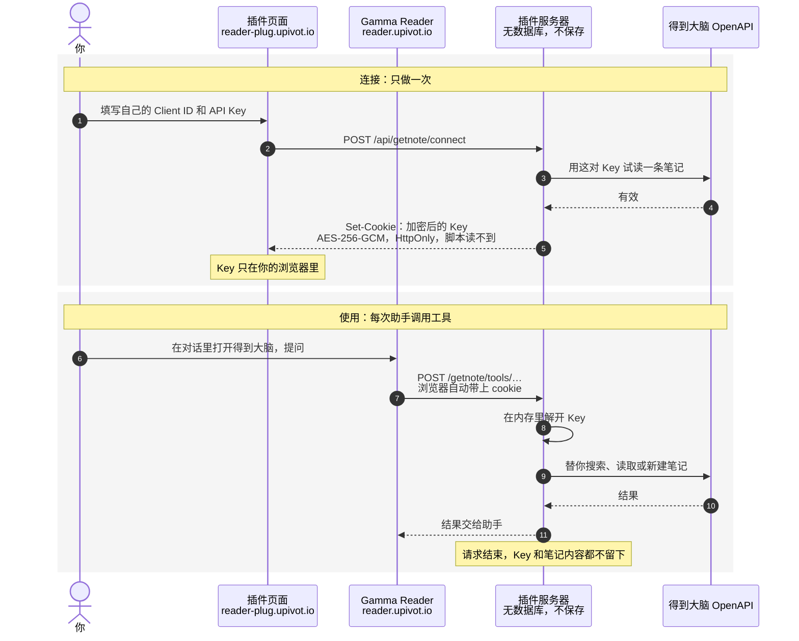

# Gamma Reader Plug

Plugins for [Gamma Reader](https://github.com/bencode/gamma-reader): connect a service once here, then turn it on in a reader conversation to give the reading assistant its tools.

The first plugin is 得到大脑: the assistant can search and read your notes, and save a new note
when you ask. You connect it with an API Key of your own.

## 工作原理

插件服务（reader-plug.upivot.io）不保存任何与你相关的东西：没有账号，没有数据库，不写文件。你填的 Client ID 和 API Key 加密后，只存在你自己浏览器的 cookie 里。每次助手调用工具，浏览器自动带上这个 cookie；服务器在内存里解开、替你调用得到大脑，请求结束就丢掉。



| 东西                                | 在哪里                                                                                                   |
| ----------------------------------- | -------------------------------------------------------------------------------------------------------- |
| 你的 Client ID 和 API Key           | 加密后在你浏览器的 cookie 里，400 天有效，每次使用自动续期                                               |
| 解开 cookie 的密钥（`PLUG_SECRET`） | 服务器配置里，所有人共用一把，不对应任何用户                                                             |
| 笔记内容                            | 只在调用时经过服务器，不保存，也不写进日志；助手读过的内容留在 Reader 的对话里，也就是你浏览器的本地存储 |
| 你的账号、身份、使用记录            | 不存在：服务器没有账号体系，也没有数据库                                                                 |
- **断开**只清除这个浏览器里的 cookie。要让 Key 彻底失效，到得到大脑开放平台的「API Key」页面删除它。建议单独为 Reader 建一个 Key。
- **换浏览器或设备**要重新填写一次，因为 Key 只在原来的浏览器里。
- **工具只读取和新建笔记**，不修改，也不删除。但 API Key 本身有你账号的全部权限，请像对待密码一样对待它。
- **所有代码都在这个仓库里**，可以自己核对，也可以自己部署一份。

## Running locally

```sh
cp .env.example .env   # fill in PLUG_SECRET
pnpm install
pnpm dev               # the page at http://localhost:5304, the server at :3304
```

Point a local reader at it with `GAMMA_PLUGINS_URL=http://localhost:5304`.

## Deploying

`docker compose -f compose.production.yml up -d --build` with the variables of `.env.example`
set. Serve it on a subdomain of the reader's domain, and set `GAMMA_PLUGINS_URL` on the reader.
